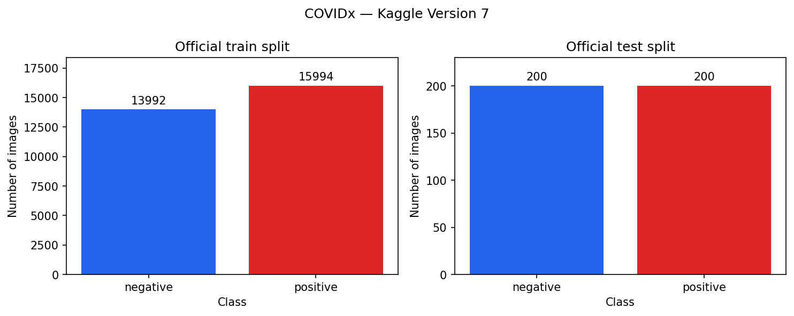
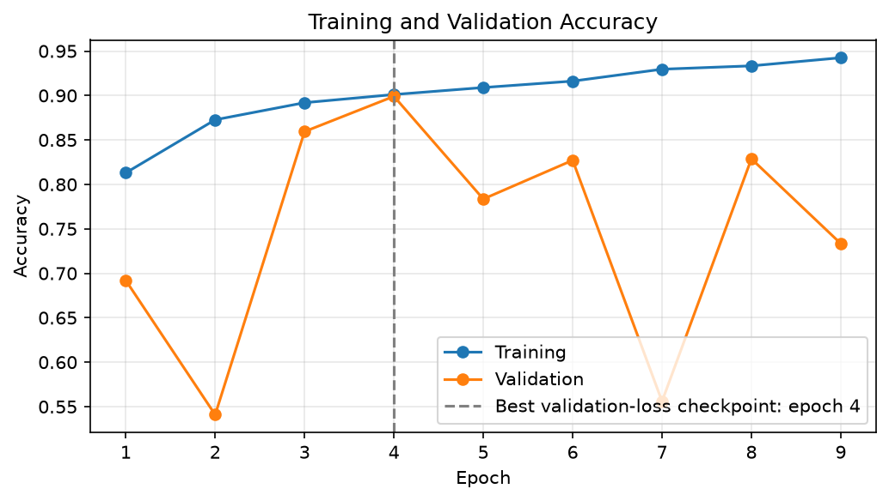
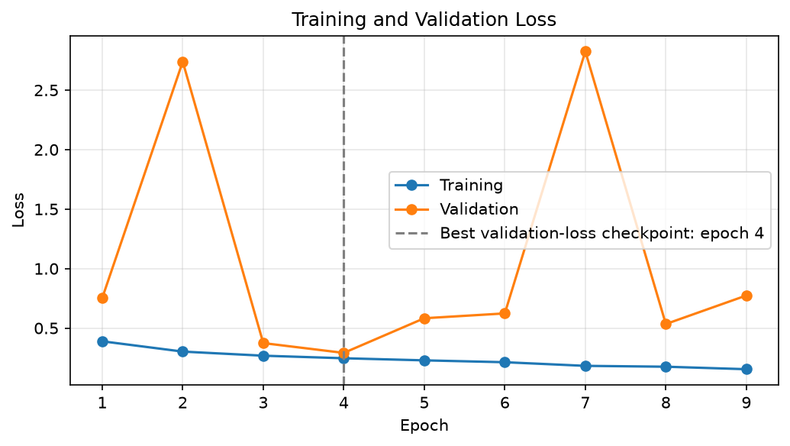
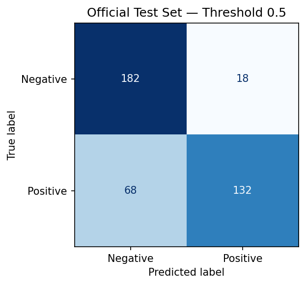
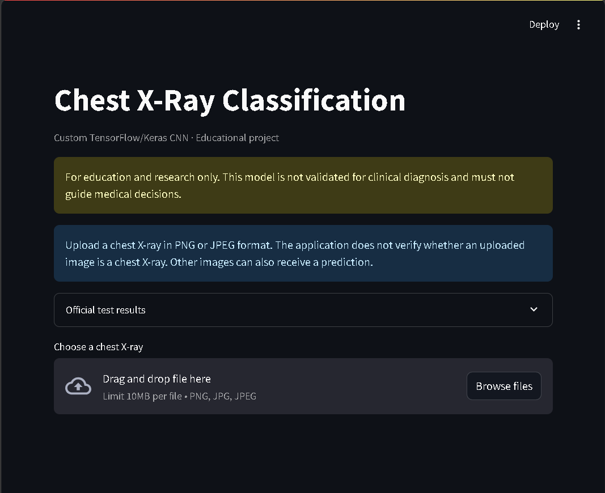

# Chest X-Ray Diagnosis using Deep Learning

[](https://github.com/umang-kumar03/Chest-X-Ray-Diagnosis-using-Deep-Learning-/actions/workflows/tests.yml)

[Open Live Showcase](https://umang-chest-xray-showcase.streamlit.app/)

The public application supports image upload and classification
and displays recorded evaluation results.

An educational project for COVID-19 classification from chest
X-ray images using a custom TensorFlow/Keras CNN and Streamlit.

## Project Status

- Dataset audit and patient-group split completed.
- Shared preprocessing and batch loading verified.
- Custom CNN trained with early stopping.
- Saved best checkpoint validated and official test evaluated.
- Streamlit application tested locally with image upload,
  prediction, and saved evaluation results.
- Public Streamlit application deployed with image upload,
  checksum-verified checkpoint download, and interactive inference.

## Dataset

Source: [COVIDx on Kaggle](https://www.kaggle.com/datasets/andyczhao/covidx-cxr2)

Selected release: Kaggle Version 7.

Verified counts from the attached label files:

| Official split | Negative | Positive | Total |
| --- | ---: | ---: | ---: |
| Train | 13,992 | 15,994 | 29,986 |
| Test | 200 | 200 | 400 |
| Total | 14,192 | 16,194 | 30,386 |

A patient-group validation subset was created from the deduplicated
official training split. The official test split was used for final
evaluation.

### Initial Checks

- All 30,386 labeled images were successfully decoded.
- Nine exact-file duplicate groups were found in the official
  training split. Ten redundant copies were excluded from derived
  manifests; original files were preserved.
- The deduplicated training pool contains 29,976 images:
  23,873 training and 6,103 validation images.
- Training and validation share no constructed patient groups
  or exact-file hashes.
- No byte-identical files were shared between official train and test.
- Near duplicates and unidentified patient relationships remain
  possible; these checks do not establish complete absence of leakage.

## Dataset Exploration



[View dataset summary](artifacts/results/dataset_summary.csv)

## Tools

Python, TensorFlow/Keras, NumPy, pandas, OpenCV, scikit-learn,
Matplotlib, Seaborn, and Streamlit.

Development is performed in VS Code. Model training was completed
on a Kaggle Tesla T4 GPU.

## Training Curves





The checkpoint was selected by minimum validation loss at epoch 4.
Early stopping ended training after 9 epochs.

[Recorded training history](artifacts/results/training_history.csv)


## Results

A custom CNN was trained using TensorFlow/Keras with training-only
augmentation and class weights. Early stopping ended training after
9 epochs. The checkpoint with the lowest validation loss was selected
at epoch 4.

The classification threshold was fixed at 0.5 before test evaluation.

| Metric | Validation | Official test |
| --- | ---: | ---: |
| Images | 6,103 | 400 |
| Accuracy | 89.91% | 78.50% |
| Positive-class precision | 92.39% | 88.00% |
| Positive-class recall | 88.64% | 66.00% |
| Positive-class F1 | 90.47% | 75.43% |
| ROC-AUC | 0.9572 | 0.9055 |

### Official Test Confusion Matrix



Of 200 COVID-positive test images, 132 were detected and 68 were
missed. Of 200 negative images, 182 were correctly classified
and 18 were classified as positive.

The validation-to-test performance gap indicates limited
generalization on this test split. Its cause has not been established.
These results do not establish clinical suitability.

An exploratory single-seed comparison on the validation split found
that a baseline trained without augmentation or class weights
outperformed the original model: 96.44% validation accuracy and
111 false negatives, compared with 89.91% and 375 false negatives.

This experiment does not support a false-negative reduction claim.
It does not isolate the individual effects of augmentation and
class weighting. Baseline official test performance is unknown.
The application continues to use the original evaluated checkpoint.

[Baseline comparison notebook](notebooks/05_baseline_comparison.ipynb)

[Validation metrics](artifacts/results/best_validation_metrics.json) ·
[Test metrics](artifacts/results/test_metrics.json) ·
[Classification report](artifacts/results/test_classification_report.csv)

## Application Preview




## Run the Streamlit App

Place the trained checkpoint at:

```text
artifacts/models/best_model.keras
```

Model weights are not included in this repository.

After installing the project dependencies and package, run
this command from the project root:

```bash
python -m streamlit run app.py
```

The app accepts PNG/JPEG files up to 10 MB and displays a model
score with a fixed classification threshold of 0.5.

It does not verify whether an uploaded image is a chest X-ray.
Scores are not calibrated medical probabilities.

## Documentation

- [Dataset setup and audit](docs/DATASET.md)
- [Model card and limitations](docs/MODEL_CARD.md)
- [Application setup and deployment](docs/DEPLOYMENT.md)


## Intended Use

For education and research only. This project is not validated
for clinical diagnosis and must not be used for medical decisions.